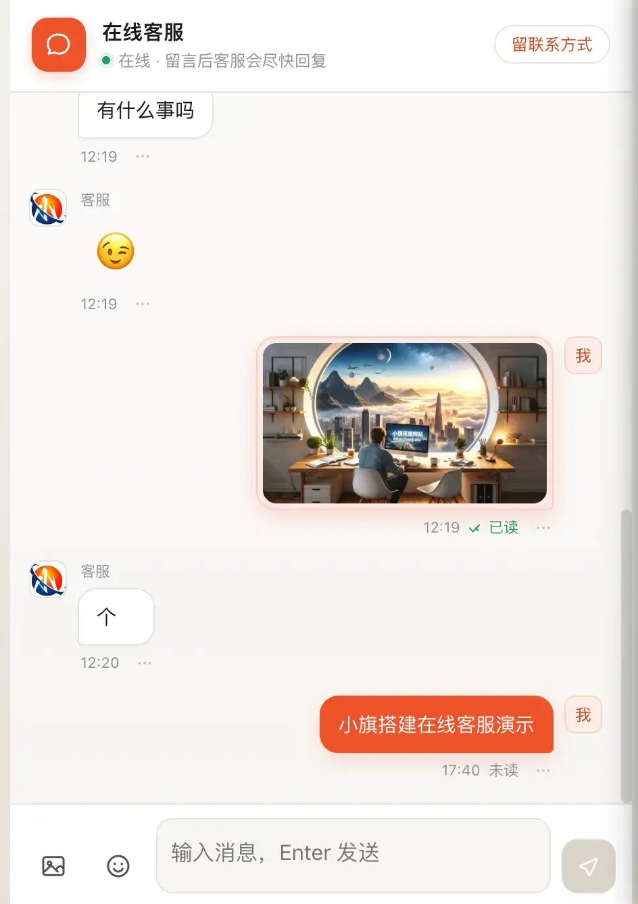
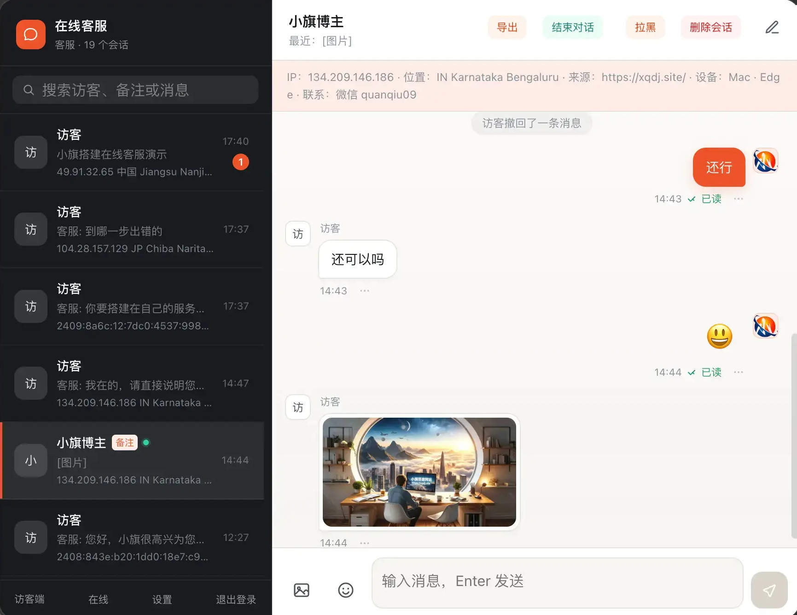

<div align="center">
  

  <h1>在线客服聊天系统</h1>

  <p>基于 <b>Cloudflare Workers + D1</b> 的轻量在线客服 · 访客免登录 · 客服有工作台 · 免费额度即可跑</p>

  <p>
    <a href="https://github.com/你的GitHub用户名/cf-kefu-chat/stargazers"></a>
    
    
    
    
    
  </p>

  <p>
    <b>零服务器</b> · <b>零数据库费用</b> · <b>一条网址同时是访客端和客服端</b>
  </p>

  <p>
    <a href="./Cloudflare部署完整教程.md"><b>📘 部署教程</b></a> ·
    <a href="#功能">功能</a> ·
    <a href="#部署">部署</a> ·
    <a href="#常见问题">常见问题</a>
  </p>
</div>

---

> ⭐ **如果这个项目帮到你，点个 Star 支持一下。** 不用下载压缩包，Fork 仓库就能部署，详细步骤见 [Cloudflare 部署完整教程（Fork 版）](./Cloudflare部署完整教程.md)。

> ⚠️ **项目声明**：本项目为开源的在线客服系统，仅供学习、研究与合法业务使用。请遵守所在地法律法规；项目作者及贡献者不对使用本项目开展的业务内容或服务承担责任。遇到问题请通过 GitHub 提交 issue，请勿将开源项目用于违法违规用途。

## 📸 界面预览

| 访客端 `/` | 客服工作台 `/agent` |
| :---: | :---: |
|  |  |

> 完整截图（含设置面板、备注弹窗、手机端）在 `预览/` 目录。

## ✨ 功能

**访客端**
- 打开网址直接聊天，**不需要注册登录**，身份存在浏览器本地，刷新不丢记录
- 文字、表情、图片（上传前自动压缩）
- 撤回（默认 120 秒内，仅发送方可撤回，双方都看到撤回提示）
- 删除（只对自己隐藏，不影响对方）
- 自己发出的消息显示 **已读 / 未读**
- 图片点击全屏查看，消息上方显示完整客服名称和头像
- 「留联系方式」按钮：手机号 / 微信 / QQ / 邮箱，可不填
- 命中关键词自动收到回复（带「自动回复」标签）

**客服工作台**
- 口令登录，首次登录输入的口令即成为系统口令，可自定义客服名称
- 会话列表按最新消息排序，带**未读角标**、对方**在线小绿点**、最后一条消息预览
- 备注顾客（仅自己可见）、**导出聊天记录 CSV**
- **对话结束语**：一键「结束对话」自动发出收尾消息并标记结束，访客再发消息自动重新开始；也能设置沉默 N 分钟自动结束
- **同一 IP 复用会话**：清缓存 / 换浏览器再进来接着原会话聊，不重复发欢迎语；支持一键合并历史重复会话
- 设置面板：店铺名称、客服名称、头像、自动欢迎语、修改口令
- 设置面板：**接待状态（在线 / 离线）**、新消息提示音、两套关键词自动回复、微信推送（Server酱）
- 设置面板：**存储用量面板 + 自动清理 + 立即清理**
- 会话信息显示**访客 IP / 归属地 / 来源网站 / 联系方式**
- 窄屏自动切换「会话列表 → 聊天」单栏布局

**其他**
- `public/embed.js`：一行配置给任意网站加右下角悬浮客服按钮（也支持 iframe 直接嵌）
- 图片默认存 D1；开通 R2 后自动优先走 R2，单张上限放宽到 5MB

## 🚀 部署

全程网页操作，不需要命令行：

1. **Star + Fork** 本仓库到你的 GitHub 账号
2. Cloudflare 建 **D1 数据库** `cf_kefu`，复制 Database ID
3. （推荐）开通 **R2**，建桶 `cf-kefu-files`
4. 改你 fork 的 `wrangler.toml`：填 `database_id`，开了 R2 就去掉 `[[r2_buckets]]` 三行注释
5. Cloudflare **Workers & Pages → Import a repository** 选你的 fork，构建 `npm install`，部署 `npx wrangler deploy`
6. 打开网址即访客端，网址后加 `/agent` 是客服端，**第一次登录输入的口令就成为系统口令**

> 数据表由 Worker 首次请求自动创建，不需要执行 migrations。
> 逐步图文（含 R2 开通问答、10 项自检、报错排查）：**[Cloudflare 部署完整教程（Fork 版）](./Cloudflare部署完整教程.md)**

## 🗂 目录结构

```
cf-kefu-chat/
├── src/index.js                   # Worker：API + 静态资源路由 + 自动建表
├── public/
│   ├── index.html                 # 访客端
│   ├── agent.html                 # 客服工作台（登录/设置/备注/结束对话）
│   ├── embed.js                   # 悬浮客服按钮
│   └── assets/                    # 共用样式与聊天核心
├── migrations/                    # 建表 SQL（仅参考，运行时会自动建表）
├── wrangler.toml                  # Cloudflare 配置
├── docs/                          # 预览图与 Logo
└── 预览/                          # 更多截图
```

## ⚙️ 配置

`wrangler.toml` 的 `[vars]` 只是**初始默认值**，部署后可在「工作台 → 设置」里改并立即生效：

| 变量 | 说明 |
| --- | --- |
| `SHOP_NAME` | 店铺名称 |
| `WELCOME_ENABLED` / `WELCOME_TEXT` | 自动欢迎语开关与内容 |
| `RECALL_WINDOW_SEC` | 撤回时限（秒） |
| `AUTO_DELETE_DAYS` | 消息自动清理天数，0 为不清理 |
| `MAX_IMAGE_MB` | 单张图片上限（D1 模式建议 1，R2 模式可 5） |

## 💻 本地开发（可选）

```bash
npm install
npx wrangler dev      # 本地起服务
```

## ❓ 常见问题

**部署后打开 500 / 服务暂时不可用？**
`wrangler.toml` 的 `database_id` 还是占位符或填错了。改成正确的 Database ID，等自动重新部署。

**图片上传失败？**
没开 R2 时图片存 D1，单张约 700KB 上限，前端已压缩到 ~400KB；大图建议开通 R2。

**忘记客服口令？**
D1 控制台执行 `DELETE FROM settings WHERE key='passcode_hash'; DELETE FROM agents;`，再打开 `/agent` 重新设置。

**怎么确认是最新版？**
访问 `/api/health`，返回 `"version":"v3.4-2026-11-25"` 即最新；同时能看到 `"storage":"r2+d1"` 或 `"d1"`。

## 🤝 参与贡献

欢迎提 Issue 和 PR，见 [CONTRIBUTING.md](./CONTRIBUTING.md)。如果这个项目对你有用，**Star ⭐** 是最好的支持。

## 📄 License

[MIT](./LICENSE) © 你的名字

<div align="center">
  <sub>Made with Cloudflare Workers · 如果好用，记得点个 Star ⭐</sub>
</div>

> （注：部分内容由豆包 AI 生成）